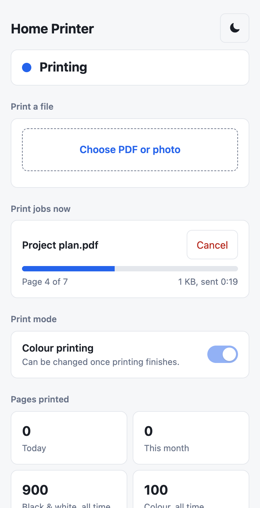

# print-dashboard

A web dashboard for a home print server. See whether the printer is ready, follow
a job page by page, cancel it, upload PDFs and photos from any device, and choose
whether colour printing is allowed. The page is built for phones.



> [!IMPORTANT]
> **This project needs a print server to talk to.** It is a companion to
> [chuckcharlie/cups-avahi-airprint](https://github.com/chuckcharlie/cups-avahi-airprint),
> a Docker image that runs CUPS and shares your printer over AirPrint. That image
> does the printing; this dashboard does not include it and can't print without
> it. They run as **two separate containers**, and only talk over the network.

## Contents

- [Why use it](#why-use-it)
- [How the two projects fit together](#how-the-two-projects-fit-together)
- [Requirements](#requirements)
- [Setup](#setup)
- [Other ways to run it](#other-ways-to-run-it)
- [Settings](#settings)
- [Naming your printer](#naming-your-printer)
- [Using the dashboard](#using-the-dashboard)
- [Colour control](#colour-control)
- [Printer compatibility](#printer-compatibility)
- [HTTP API](#http-api)
- [Security](#security)
- [Data and privacy](#data-and-privacy)
- [Troubleshooting](#troubleshooting)
- [Development](#development)
- [Project layout](#project-layout)
- [Licence](#licence)

## Why use it

With AirPrint through CUPS, a phone hands the whole job to the server and is free
straight away, even for a large file. What you lose is any view of what happens
next. This dashboard adds that back:

- Printer state, with clear alerts for out of paper, paper jams and open covers
- The current job, with its page count and live progress
- A Cancel button
- Pages printed today, this month and all time
- A history of recent jobs
- Upload of PDF, JPEG and PNG files from a browser, with no app to install
- Black and white by default, with colour allowed only when you turn it on

## How the two projects fit together

```
   iPhone, iPad, Mac                     Any browser
          │ AirPrint                         │ https or http, port 8080
          ▼                                  ▼
┌─────────────────────────┐  IPP   ┌─────────────────────────┐
│ cups-avahi-airprint     │◄───────│ print-dashboard         │
│ container               │  :631  │ container (this project)│
│ Holds the queue, prints │        │ Shows status, sends     │
└───────────┬─────────────┘        │ uploads, keeps history  │
            │ IPP                  └───────────┬─────────────┘
            ▼                                  │ Status only
      Network printer  ◄───────────────────────┘
```

- The **CUPS container** owns the queue and does all the printing. It works on
  its own if the dashboard is stopped.
- The **dashboard container** asks CUPS for jobs and queue state, and hands it
  uploaded files. It also asks the printer directly for status, if you give it
  the printer's address.
- They share **no files and no Docker network**. CUPS can be in another container,
  or on another machine. The dashboard needs only a URL and the CUPS admin login.

The dashboard is not a fork of the CUPS image and contains none of its code. It
was tested with image version `2.1.3`, and should work with any CUPS server that
has a queue with a PPD. See [Printer compatibility](#printer-compatibility).

## Requirements

- Docker with Compose, on an always-on machine such as a home server or NAS.
  Linux is needed for the CUPS container's host networking.
- A network printer that supports IPP. Most Wi-Fi printers from the last ten years
  do, and anything advertising AirPrint will.
- A trusted home network. See [Security](#security).

## Setup

This sets up both containers on one machine.

**1. Get the files.** Make a folder for the print server, and copy in two files
from this repo: [`examples/compose.yml`](examples/compose.yml) as `compose.yml`,
and [`.env.example`](.env.example) as `.env`.

```bash
mkdir print-server && cd print-server
curl -o compose.yml https://raw.githubusercontent.com/nitin23c/print-dashboard/main/examples/compose.yml
curl -o .env https://raw.githubusercontent.com/nitin23c/print-dashboard/main/.env.example
chmod 600 .env
```

**2. Fill in `.env`.** Set a long random `CUPSPASSWORD`, your `TZ`, and your
printer's address as `PRINTER_IP`. Give the printer a fixed address in your
router so this doesn't change. Both containers read this file.

**3. Start both containers.**

```bash
docker compose up -d --build
```

**4. Create the print queue.** This uses IPP Everywhere, so no printer driver is
needed. Replace `printadmin` with your `CUPSADMIN` and `192.0.2.20` with your
printer's address.

```bash
docker exec cups su -s /bin/sh printadmin -c "lpadmin -p Home_Printer -D 'Home Printer' -E -v ipp://192.0.2.20:631/ipp/print -m everywhere -o printer-is-shared=true -o printer-error-policy=retry-job -o media-default=iso_a4_210x297mm -o PageSize=A4"
```

Use `na_letter_8.5x11in` and `Letter` for the last two if you print on US Letter.
`retry-job` makes CUPS keep trying when the printer has a problem, so a job resumes
after you add paper instead of stopping the queue.

Run it as your admin user, because the command is refused as root. If your
printer's path isn't `/ipp/print`, find it with `ippfind` or in the printer's
manual. You can also add the queue in the CUPS web page at `http://<server>:631`:
tick **Share This Printer**, and note the queue name for `CUPS_QUEUE`.

**5. Recommended CUPS settings.** Add these lines to `config/cupsd.conf`, then run
`docker compose restart cups`:

```
MaxJobTime 86400
PreserveJobFiles No
PreserveJobHistory 1h
```

The first lets a job wait up to a day, for instance while the printer is off,
instead of failing after a few hours. The other two stop CUPS keeping your
documents after printing and limit how long it keeps job details. The dashboard
keeps its own history.

**6. Open the dashboard** at `http://<server>:8080`, and check that it says
**Ready**. On an iPhone, the printer now also appears in the normal Print menu as
`Home Printer @ cups-airprint`.

To update later, run `docker compose pull && docker compose up -d --build`.

## Other ways to run it

### Dashboard only, with CUPS elsewhere

If CUPS already runs on another machine or in another stack, use
[`examples/compose.dashboard-only.yml`](examples/compose.dashboard-only.yml), and
set `CUPS_URL`, `CUPSADMIN` and `CUPSPASSWORD` in `.env`. The CUPS server must
accept connections from the dashboard's machine. The CUPS image does this by default.

### With plain docker

```bash
git clone https://github.com/nitin23c/print-dashboard.git
docker build -t print-dashboard print-dashboard
docker run -d --name print-dashboard --restart unless-stopped \
  --env-file .env \
  -e CUPS_URL=http://192.0.2.10:631 \
  -p 8080:8080 \
  -v print-dashboard-data:/data \
  print-dashboard
```

### Host network

The dashboard runs fine on the host network too. Set `network_mode: host`, remove
`ports`, `extra_hosts` and `CUPS_URL`, and it uses `http://127.0.0.1:631`. Change
the port with `PORT` if 8080 is taken.

### Bind mounts

The container runs as user 1000, not root. If you use a folder instead of a named
volume for `/data`, give that user access:

```bash
sudo chown -R 1000:1000 ./dashboard-data
```

### Without Docker

You need Python 3.10 or newer and `pdfinfo` from `poppler-utils`. There is nothing
to install from pip.

```bash
CUPS_URL=http://192.0.2.10:631 CUPSADMIN=printadmin CUPSPASSWORD=... \
  DB_PATH=./history.db python3 -m print_dashboard
```

## Settings

All settings are environment variables. `CUPSADMIN` and `CUPSPASSWORD` use the
same names and defaults as the CUPS image, so one `.env` can serve both containers.

| Variable | Default | Used for |
|---|---|---|
| `CUPS_URL` | `http://127.0.0.1:631` | Where CUPS is |
| `CUPS_QUEUE` | `Home_Printer` | Name of the queue, with underscores as CUPS shows it |
| `CUPSADMIN` | `cupsadmin` | CUPS admin user. Needed for job names, Cancel, page totals and colour |
| `CUPSPASSWORD` | Same as `CUPSADMIN` | CUPS admin password |
| `PRINTER_IP` | Empty | Printer's address, for direct status. Without it, only the queue is watched |
| `DASHBOARD_TITLE` | `Home Printer` | Name at the top of the page |
| `DASHBOARD_NOTE` | Empty | A line of your own under Printer, such as where the spare paper is |
| `MAX_UPLOAD_MB` | `100` | Largest upload |
| `MAX_COPIES` | `20` | Most copies per upload |
| `KEEP_DAYS` | `90` | Days of history to keep |
| `DB_PATH` | `/data/history.db` | History file. The saved colour definition goes in the same folder |
| `BIND_ADDRESS` | `0.0.0.0` | Address to listen on |
| `PORT` | `8080` | Port to listen on |
| `TZ` | `UTC` | Timezone for today and this month |

## Naming your printer

The name appears in two places, and each has its own setting. Neither needs a code
change.

| Where it shows | Set by | How to change it |
|---|---|---|
| Top of the dashboard and the browser tab | `DASHBOARD_TITLE` | Set it in `.env`, then run `docker compose up -d dashboard` |
| Print menu on iPhones, iPads and Macs | The queue's description in CUPS | Use `-D` when creating the queue, or the command below |

For example, in `.env`:

```
DASHBOARD_TITLE=Office Printer
```

To change the name in the Print menu on an existing queue, replace `printadmin`
with your `CUPSADMIN`:

```bash
docker exec cups su -s /bin/sh printadmin -c "lpadmin -p Home_Printer -D 'Office Printer'"
```

Devices may keep showing the old name for a short while.

The part after the `@` comes from the CUPS image's `AVAHI_HOSTNAME` setting. The
queue's own name, `Home_Printer` in these examples, is separate. If you pick a
different one when creating the queue, set `CUPS_QUEUE` to match.

## Using the dashboard

**To print a file,** tap **Choose PDF or photo**, pick one or more files, set the
copies and tap **Print**. Keep the page open until it says **Sent**. After that the
server has the file, and you can lock your phone.

- Accepted types are PDF, JPEG and PNG. The file's contents are checked, not its name.
- Photos from an iPhone's library arrive as JPEG, because the page asks for that.
- Photos are scaled to fill the page and rotated to fit.
- Word, Excel and other formats aren't accepted. Export them as PDF first.

**To switch between light and dark,** tap the sun or moon at the top right. The
page follows your device's setting until you do. Your choice is saved in that
browser only, so each person and device keeps their own.

**To add it to a phone's Home Screen,** open the page in Safari and choose
Share, then Add to Home Screen.

**When something goes wrong,** the banner at the top says what to fix: out of
paper, a jam, an open cover, an unreachable printer, or a failed CUPS login. Jobs
wait in the queue and continue once the problem is fixed.

**Printing from a phone without the dashboard** works as normal through AirPrint.
Those jobs show up here too.

## Colour control

| Toggle | Job asks for colour | Prints in |
|---|---|---|
| Off | Yes or no | Black and white |
| On | Yes | Colour |
| On | No | Black and white |

Setting a default isn't enough, because a phone can ask for colour on any job and
override it. So with the toggle off, the dashboard replaces the queue's PPD with a
copy that has no colour options. It keeps the original in the data folder as
`color.ppd`, and puts it back when you turn the toggle on.

- The toggle is locked while jobs are in the queue.
- A newly created queue starts with colour on. Turn the toggle off once if you want
  black and white by default, and again whenever you rebuild the queue.
- Keep the `/data` volume. If `color.ppd` is lost while the toggle is off, turning
  it on fails until you recreate the queue.

## Printer compatibility

| Feature | Needs |
|---|---|
| Queue status, job list, uploads, Cancel, history | Any CUPS queue |
| Page totals | The queued file is a PDF, JPEG, PNG or Apple raster. Other formats show progress without a total |
| Live progress | The printer reports completed pages to CUPS, or it has HP status pages |
| Out of paper, jam and cover alerts | `PRINTER_IP` set, and a printer with IPP at `/ipp/print` or HP status pages |
| Sleep state, lifetime counters | HP printers with status pages at `/DevMgmt/` |
| Colour toggle | A colour queue with a PPD. `-m everywhere` creates one |

Testing so far has used one printer, an HP Smart Tank 510. Other printers are
expected to work through standard IPP, but that hasn't been proven. Reports are
welcome.

## HTTP API

Every `POST` must carry the header `X-Print-Dashboard: 1`. Replies are JSON.

| Request | Does |
|---|---|
| `GET /api/status` | Everything the page shows |
| `GET /healthz` | Returns `{"ok": true}` if the web server is up. Doesn't check CUPS |
| `POST /api/print` | Prints the request body. Query: `copies`, `color=1`. Header: `X-File-Name`, URL-encoded |
| `POST /api/cancel/<id>` | Cancels a job |
| `POST /api/color/on`, `/api/color/off` | Sets the colour mode. Returns 409 while jobs are queued |

```bash
curl -X POST 'http://server:8080/api/print?copies=2' \
  -H 'X-Print-Dashboard: 1' -H 'X-File-Name: report.pdf' \
  --data-binary @report.pdf
```

## Security

**The dashboard has no login.** Anyone who can reach it can see job names, print,
cancel jobs and change the colour setting. It is meant for a trusted home network.

- **Never expose it to the internet.** Don't forward its port on your router. If
  you want to reach it from outside, use a VPN such as Tailscale or WireGuard.
- To restrict it further, put it behind a reverse proxy with a login, or set
  `BIND_ADDRESS` to a private interface.
- Treat `.env` as a secret: `chmod 600 .env`, and never commit it. It holds the CUPS
  admin password, which can change printers and CUPS settings.
- The dashboard sends that password to CUPS over plain HTTP, using Basic
  authentication, so keep the two on a network you trust.
- The CUPS image exposes port 631 to your network, as its own README explains. Set
  a strong password, because the default is the same as the user name.
- `cups-avahi-airprint` 2.1.3's start script logs the admin password. The `command`
  line in the example compose file removes that. Keep it, and check it again if you
  change the image version.

What the dashboard does for you: the password stays out of logs, the status API and
the page. Pages from other sites can't trigger actions, because every action needs
a custom header. File types are checked from their contents, names shown on the
page are escaped, and a strict Content-Security-Policy is sent. The container runs
as a non-root user.

To report a security problem, please open a GitHub issue without exploit details and
ask for a private contact.

### HTTPS with a reverse proxy

The dashboard serves plain HTTP, and any reverse proxy can add HTTPS. Send all paths
to port 8080. For example, with Caddy:

```
print.example.com {
    tls internal
    reverse_proxy 192.0.2.10:8080
}
```

## Data and privacy

| Kept | Where | For how long |
|---|---|---|
| Job name, owner, size, pages and status | `/data/history.db` | `KEEP_DAYS` |
| The queue's colour definition | `/data/color.ppd` | Until replaced |
| Light or dark choice | The viewer's own browser | Until they clear it |

- **Uploaded documents are never written to disk by the dashboard.** They pass
  through memory to CUPS. To count pages it briefly fetches the queued file into a
  temporary file, and deletes it straight away.
- Job names can be personal, so treat the data folder accordingly.
- Nothing is sent anywhere except to your CUPS server and printer. The page loads
  no outside fonts, scripts or trackers.
- To clear the history, stop the container and delete `history.db`.

To back up, copy the `/data` volume. Back up `config/` for the CUPS side, and keep
it private, because it contains CUPS's TLS key.

## Troubleshooting

| What you see | Likely cause | Fix |
|---|---|---|
| **Print server problem**, can't reach CUPS | Wrong `CUPS_URL` or `CUPS_QUEUE`, or CUPS is down | Check with `curl http://<cups>:631/printers/`. The queue name must match exactly |
| **CUPS login failed** | `CUPSADMIN` or `CUPSPASSWORD` differs from CUPS | Fix `.env`, then `docker compose up -d`. CUPS still reads status with a bad login, so the rest of the page can look normal |
| Jobs show as `Document` | Same as above | Same as above |
| **Printer not reachable** | Printer off or its address changed | Check `PRINTER_IP`, and reserve the address in your router |
| **Queue paused** | CUPS stopped the queue after an error | Run `docker exec cups su -s /bin/sh <admin> -c "cupsenable Home_Printer"` |
| No page total | The job's format isn't one the dashboard can count, or the file was already gone | Harmless. Progress still shows if the printer reports it |
| False out-of-paper alert | Shouldn't happen: stale `-report` reasons are ignored | Open an issue with the printer model |
| Upload fails with a proxy | Proxy's upload limit or timeout | Raise the limit above `MAX_UPLOAD_MB` |
| Permission error on `/data` | A bind mount owned by root | See [Bind mounts](#bind-mounts) |
| `host.docker.internal` doesn't resolve | `extra_hosts` line missing | Copy it from `examples/compose.yml` |
| Printer missing from iPhone's Print menu | A CUPS or AirPrint matter | See the [CUPS image's README](https://github.com/chuckcharlie/cups-avahi-airprint#readme). If the host runs `avahi-daemon`, it takes port 5353 and hides the queue |
| `lpadmin: Forbidden` | Ran as root | Run as your admin user, as in step 4 |

Logs are in `docker logs print-dashboard`.

## Development

There are no runtime dependencies beyond Python and `pdfinfo`.

```bash
python3 -m unittest discover -s tests -t .
```

The tests run the real dashboard against `tests/support.py`, a fake CUPS and printer
that speak real IPP over HTTP, so no printer or paper is needed. The fake follows
real CUPS on details that matter, such as answering status requests despite a bad
password.

| File | Covers |
|---|---|
| `tests/test_units.py` | Settings, IPP encoding and malformed replies, file types, page counts, PPD edits, history |
| `tests/test_integration.py` | The CUPS client, printer status, the monitor, every endpoint, and upload edge cases |
| `tests/test_browser.py` | The real page in a browser: layout from 320 to 1280 pixels, touch, script injection, uploads, Cancel and the toggle |

Browser tests are skipped unless Playwright is installed:

```bash
pip install playwright
playwright install chromium
python3 -m unittest tests.test_browser
```

Set `BROWSER_CHANNEL=chrome` to use an installed Chrome instead of downloading
Chromium.

## Project layout

Each module has one job, so you can reuse or replace it on its own.

| File in `print_dashboard/` | Does |
|---|---|
| `config.py` | Reads settings from the environment |
| `ipp.py` | A small IPP client, with no dependencies |
| `cups.py` | Everything asked of CUPS: jobs, queue state, printing, Cancel and colour |
| `printer.py` | Direct printer status through IPP, and HP status pages |
| `pages.py` | Identifies files and counts their pages |
| `ppd.py` | Edits the PPD for colour control |
| `history.py` | Saves finished jobs in SQLite |
| `monitor.py` | The polling loop, and the state the page shows |
| `server.py` | The web server and its routes |
| `static/` | The page: `index.html`, `app.js`, `theme.js` and `style.css` |

## Licence

MIT, see [LICENSE](LICENSE). This covers this project only.
[cups-avahi-airprint](https://github.com/chuckcharlie/cups-avahi-airprint) is a
separate project under GPL-3.0 and isn't included here. The Docker image contains
`poppler-utils`, which is licensed under the GPL.
